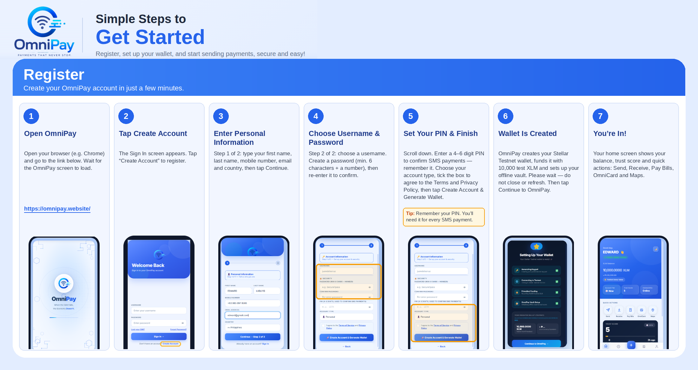
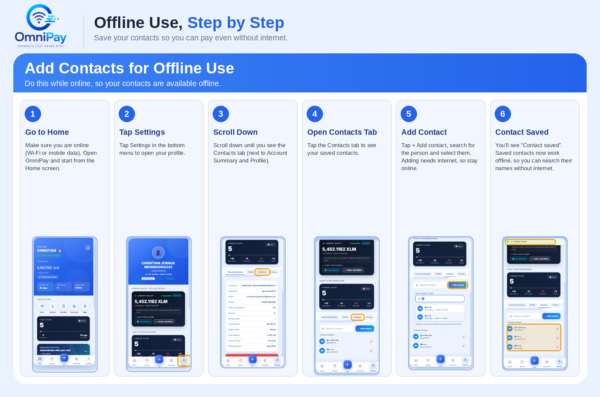
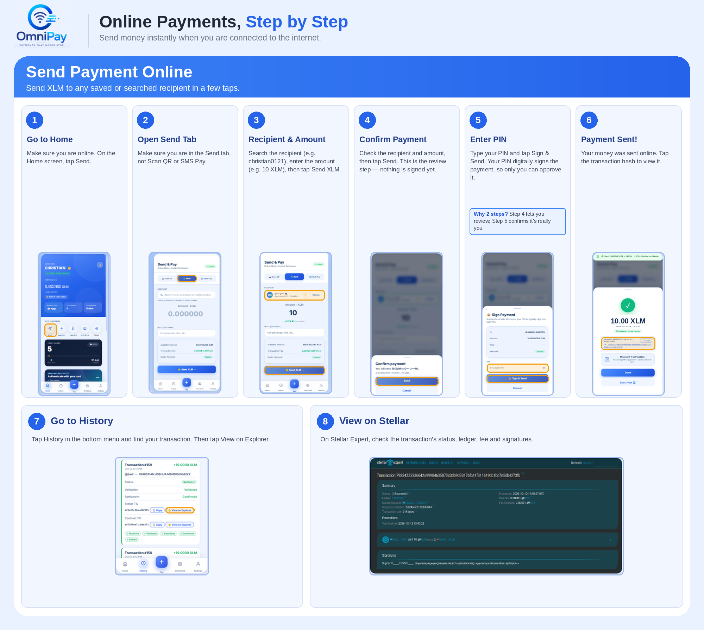
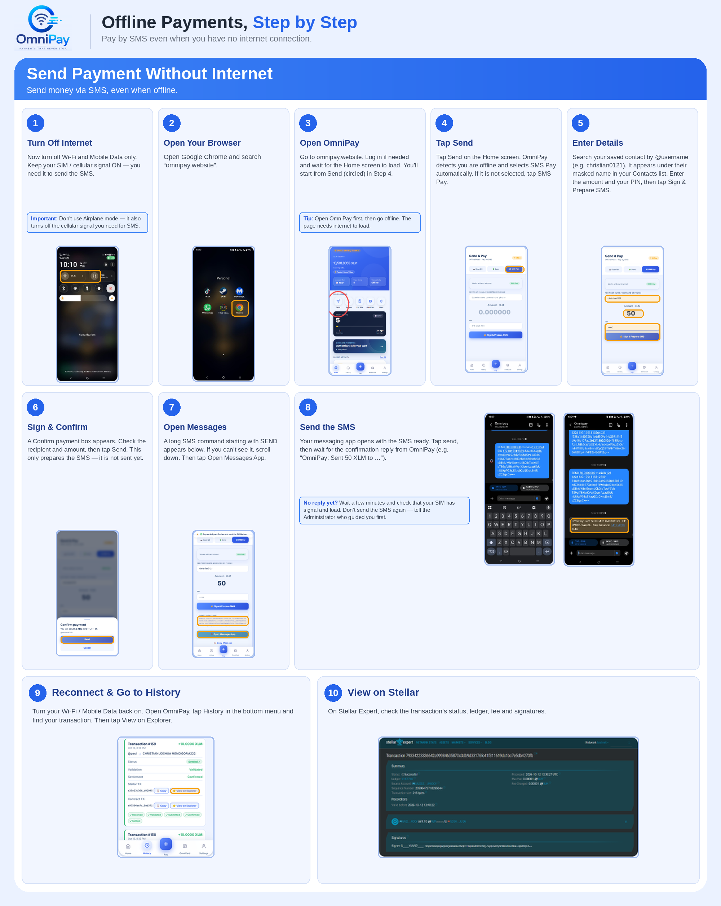

# OmniPay SMS Relay

OmniPay lets a user send a Stellar Testnet payment by plain SMS, with no internet connection on the sender's phone. An Android phone running the [android-sms-gateway](https://docs.sms-gate.app) app receives the SMS and forwards it to this server through a webhook. The server validates the request, executes the XLM payment on Stellar Testnet, records the settlement through a Soroban smart contract, tracks every step in Firestore for the monitoring dashboard, and texts a confirmation back.

The same Express service also serves the OmniPay web app (PWA) and the admin monitoring dashboard, so the app and the relay always run the same version.

```
Phone (no internet) --SMS--> Gateway phone (android-sms-gateway)
     --HTTP webhook--> OmniPay server (Render) --> Firestore (lookup + record)
     --> Stellar Testnet payment + Soroban settle() --> Firestore (update)
     --HTTP (Basic Auth)--> Gateway phone --SMS--> Sender and recipient (confirmation)
                                   Firestore --live stream--> Monitoring dashboard
```

## Onchain activity (Stellar Testnet)

| Contract | Role | Stellar Expert |
|---|---|---|
| v1 `CCR4IAHHPOKX6SEM2ED5N5AKIO4QRBEJ7AA5UH4LZYBUTRAIH7XTD6TH` | Live relay and app, where user settlements are recorded | [View activity](https://stellar.expert/explorer/testnet/contract/CCR4IAHHPOKX6SEM2ED5N5AKIO4QRBEJ7AA5UH4LZYBUTRAIH7XTD6TH) |
| v2 `CB6MGNV7JM7HFP6AUBMLQMK42P3MTBKLLRF577ZWKIXG4UIIGEJ3TPAM` | Sprint 2 contract, Week 1 deliverable | [View activity](https://stellar.expert/explorer/testnet/contract/CB6MGNV7JM7HFP6AUBMLQMK42P3MTBKLLRF577ZWKIXG4UIIGEJ3TPAM) |

Network: Testnet. Test XLM only, no real money.

## Project links

| | |
|---|---|
| GitHub repository (Sprint 2, Week 1 branch) | https://github.com/Christian0121-stack/Omnipay/tree/sprint-2-week-1 |
| Render (web hosting / backend server) | https://omnipay-m6hl.onrender.com |
| Render monitoring dashboard | https://omnipay-m6hl.onrender.com/admin |
| GoDaddy (domain name) | https://omnipay.website/ |
| Custom domain monitoring dashboard | https://omnipay.website/admin |
| Health check | https://omnipay.website/health |
| Soroban contract v2 (Testnet, Sprint 2) | [`CB6MGNV7JM7HFP6AUBMLQMK42P3MTBKLLRF577ZWKIXG4UIIGEJ3TPAM`](https://stellar.expert/explorer/testnet/contract/CB6MGNV7JM7HFP6AUBMLQMK42P3MTBKLLRF577ZWKIXG4UIIGEJ3TPAM) |
| Soroban contract v1 (Testnet, used by the live relay) | [`CCR4IAHHPOKX6SEM2ED5N5AKIO4QRBEJ7AA5UH4LZYBUTRAIH7XTD6TH`](https://stellar.expert/explorer/testnet/contract/CCR4IAHHPOKX6SEM2ED5N5AKIO4QRBEJ7AA5UH4LZYBUTRAIH7XTD6TH) |
| Week 1 evidence | [`docs/week1-evidence.md`](docs/week1-evidence.md) |
| SMS gateway number (send test SMS here) | `09612490625` (+63 961 249 0625) |

The admin dashboard is a public page, but all of its data endpoints require the admin key. The key is given to reviewers separately and is never stored in this repository.

For the complete endpoint reference see [API_DOCUMENTATION.md](API_DOCUMENTATION.md).

## User guide (step by step)

Four one-page guides walk a new user through the app. Follow them in this order.

> **Important: add contacts before you go offline.** With no internet the app cannot search for other OmniPay users. Offline, the recipient search shows only the people you already saved under **Settings, Contacts**, so those are the recipients you can pick for **SMS Pay**. Adding a contact needs internet, so save everyone you plan to pay while you are online. You can still type an exact username or mobile number by hand, but it cannot be checked offline, and a typo is rejected by the relay (`recipient-not-found`).

### 1. Register



### 2. Add contacts (do this while online)



### 3. Send a payment online



### 4. Send a payment by SMS (no internet)



## Part of

Instawards SOW: OmniPay v2 (THE MOON PROJECT, Christian Mendigoria and Marielle Lingad), 30-day sprint.

**Sprint 2, Week 1 deliverable (this branch):** settlement contract v2 deployed on Stellar Testnet with the first atomic XLM settlements, and the Stellar CLI scripts with a deployment manifest.

The web app, relay and dashboard from Sprint 1 are unchanged and still run against contract v1. Contract v2 is deployed and verified separately on Testnet, see [Settlement contract v2](#settlement-contract-v2-sprint-2-week-1).

See [Status](#status) for what is done and what is still open.

## What Sprint 2, Week 1 adds

- **Settlement contract v2:** a new contract that moves the XLM through the Stellar Asset Contract and records the settlement in the same transaction. If either part fails, the whole transaction reverts, so a payment can no longer exist without its record.
- **Controls:** one-time `initialize`, an admin, pause and unpause, a per-payment cap, admin transfer and an in-place `upgrade`, with events for each action.
- **Tests:** 23 contract tests covering the token transfer, atomic revert, duplicates, pause, cap, admin rules, upgrade and emitted events.
- **Stellar CLI scripts:** repeatable scripts in `scripts/` to check the setup, build, deploy and verify a contract, and a deployment manifest in `deployments/testnet.json`.
- **Admin dashboard updates:** the Users tab shows the day each account was created, can be filtered by it and searched by phone number in any format. The Uploads tab shows one card per user with screenshots grouped by day, a date filter, search and download.
- **Evidence:** v2 deployed on Testnet, initialized, and three atomic XLM settlements and a rejected replay, all listed in [`docs/week1-evidence.md`](docs/week1-evidence.md).

## What Week 3 added (Sprint 1)

- **Deployment:** the relay, web app, PWA files and admin page run as a single Render web service. The domain `omnipay.website` is registered at GoDaddy and points to the web app.
- **Soroban settlement record:** the contract is deployed on Stellar Testnet and the relay calls `settle()` for every settled payment. Each payment leaves two public transactions: the XLM payment and the contract call.
- **Settlement order:** the XLM payment is submitted first and the contract record is written after the payment is confirmed, so a contract record can never exist without a payment.
- **Monitoring dashboard:** `/admin` streams live relay records from Firestore and shows every request, including rejected ones, with a five-stage tracker, rejection reasons, Stellar Explorer links and a replay audit tool.
- **User history:** signed-in users see their own requests in the app History screen through `GET /api/my-transactions` and its live stream.
- **Offline operation:** the web app detects loss of connectivity and switches to SMS Pay. A service worker pre-caches the app shell and CDN libraries.
- **Health check:** `GET /health` reports Firestore, Horizon and Soroban status with latency.

## Requirements

- Node.js 22.18 or newer (required by `firebase-admin`)
- A Firebase project with Firestore enabled and a service account JSON (Firebase Console, Project settings, Service accounts, Generate new private key)
- An Android phone running [android-sms-gateway](https://sms-gate.app) (local server or cloud mode) with SIM and SMS capability
- A funded Stellar Testnet account for each OmniPay user (via [Friendbot](https://friendbot.stellar.org))
- A Stellar Testnet account for the settlement signer, added as a signer on each user account (see `GET /api/settlement-signer`)
- `stellar-sdk` v11 or newer when `SOROBAN_CONTRACT_ID` is set

## Setup

```bash
npm install
cp .env.example .env   # then fill in the values below
npm start              # runs: node server.js
```

The server listens on `PORT` (default `3000`). It serves the web app, the PWA files (`sw.js`, `manifest.webmanifest`) and the admin page from the `public/` folder, plus the OmniPay logo assets from the project root.

On Render the same start command is used (`node server.js`). Set the environment variables in the Render dashboard and provide the Firebase service account JSON as a secret file, then point `FIREBASE_SERVICE_ACCOUNT_PATH` at it.

> **Never commit `.env` or `serviceAccountKey.json`.** Both must be listed in `.gitignore`. They contain the gateway credentials, the webhook signing secret, the settlement signer secret, the admin key and the Firebase Admin private key.

## Environment variables

Set each variable once in `.env` (or in the Render dashboard). The server exits at startup if `FIREBASE_PROJECT_ID` or `STELLAR_HORIZON_URL` is missing, or if the service account file cannot be read.

| Variable | Required | Description |
|---|---|---|
| `PORT` | no | Port to listen on. Default `3000`. |
| `FIREBASE_PROJECT_ID` | **yes** | Your Firebase project ID. |
| `FIREBASE_SERVICE_ACCOUNT_PATH` | yes (file must exist) | Path to the Firebase service account JSON. Default `./serviceAccountKey.json`. |
| `STELLAR_HORIZON_URL` | **yes** | Horizon endpoint, `https://horizon-testnet.stellar.org` for Testnet. |
| `STELLAR_NETWORK_PASSPHRASE` | no | Default is the Testnet passphrase, `Test SDF Network ; September 2015`. |
| `SMS_GATEWAY_USE` | no | `local` or `cloud`. Default `local`. |
| `SMS_GATEWAY_LOCAL_URL` | if `local` | Base URL of the gateway phone's Local Server, for example `http://192.168.1.50:8080`. |
| `SMS_GATEWAY_PUBLIC_URL` | no | Override for the Cloud Server URL. Default `https://api.sms-gate.app/3rdparty/v1`. |
| `SMS_GATEWAY_USERNAME` | yes | Basic-auth username for sending SMS back through the gateway. |
| `SMS_GATEWAY_PASSWORD` | yes | Basic-auth password for the gateway. |
| `SMS_GATEWAY_WEBHOOK_SECRET` | yes | Signing key from the gateway app (Settings, Webhooks). Used to verify the `X-Signature` and `X-Timestamp` headers on inbound webhook calls. **If empty, every webhook call is rejected.** |
| `ADMIN_API_KEY` | for admin endpoints | Secret sent in the `x-admin-key` header to use the monitoring and audit endpoints. If unset they return `503`. |
| `ADMIN_RESET_PASSWORD` | no | Password the dashboard sets when an admin resets a user's password. Set your own value. The user should change it after signing in. |
| `ADMIN_RESET_PIN` | no | SMS PIN (4 to 6 digits) the dashboard sets when an admin resets a user's PIN. Set your own value. |
| `SETTLEMENT_SIGNER_SECRET` | yes | Secret key of the settlement signer. Signs the Stellar payment and the Soroban invocation. If unset, payments cannot be settled. |
| `SOROBAN_RPC_URL` | no | Default `https://soroban-testnet.stellar.org`. |
| `SOROBAN_CONTRACT_ID` | for Soroban | Settlement contract address (starts with `C`). If empty, payments settle on Horizon only and a startup warning is shown. |
| `SOROBAN_SETTLE_FUNCTION` | no | Contract function used for settlement. Default `settle`. |
| `SOROBAN_POLL_ATTEMPTS` | no | Confirmation polling attempts. Default `30`. |
| `SOROBAN_POLL_INTERVAL_MS` | no | Delay between polling attempts. Default `1000`. |
| `SOROBAN_SEND_ATTEMPTS` | no | Attempts when submitting the contract call. Default `3`. |
| `SOROBAN_SEND_RETRY_DELAY_MS` | no | Base delay between submit retries. Default `1500`. |
| `REQUIRE_SIGNED_SMS` | no | `true` or `false`. When `true`, unsigned `SEND` SMS commands are rejected (see [Authentication](#authentication)). Default `true`. |
| `SIGNATURE_MAX_SKEW_MS` | no | Allowed timestamp difference for signed requests. Default `300000` (5 minutes). |
| `RELAY_RECORD_TTL_DAYS` | no | Days before `relay_requests` and `omnipay_used_nonces` records get an `expiresAt` date. Default `7`. |
| `SMS_DEDUP_WINDOW_MS` | no | Window in which an identical SMS from the same sender is treated as a duplicate gateway delivery. Default `3000`. |
| `SMS_ASSET_LABEL` | no | Asset label used in SMS replies. Default `XLM`. |
| `APP_PAYMENT_SMS` | no | Set to `false` to stop confirmation SMS after payments made through `/api/send`. Default `true`. |
| `ALLOWED_ORIGINS` | no | Comma-separated list of allowed CORS origins. |
| `EXPLORER_BASE_URL` | no | Explorer base URL used in `--proof-check` output. Default `https://stellar.expert/explorer/testnet`. |

## SMS command format

Texted to the gateway phone's number, not case-sensitive:

```
SEND <amount> <recipient> <pin>
  e.g. SEND 50 09171234567 1234
  e.g. SEND 50 juan_delacruz 1234

BAL <pin>        (or BALANCE <pin>)
  -> replies with the sender's XLM balance
```

`<recipient>` can be another OmniPay user's registered mobile number or username. `<amount>` must be a positive number with at most 7 decimal places and `<pin>` is 4 to 6 digits.

> In the app, offline recipient search only finds saved contacts. Add the recipient under **Settings, Contacts** while online before you use **SMS Pay** (see the [user guide](#user-guide-step-by-step)).

### Signed (authenticated) variant

```
SEND <amount> <recipient> <pin> SIG <timestamp> <nonce> <requestId> <signature>
```

The signature is an Ed25519 signature (base64, 64 raw bytes) over the string

```
OMNIPAY-v1|senderId|recipientId|amount|timestamp|nonce|requestId
```

produced with the sender's Stellar keypair, where:

- `senderId` is the sender's Firestore `users` document ID (the Firebase Auth UID), not the phone number.
- `recipientId` is the recipient exactly as written in the command.
- `amount` is formatted with 7 decimal places (`50` becomes `50.0000000`).
- `timestamp` is Unix time in milliseconds.
- `nonce` and `requestId` must not contain `|`. `requestId` must match `^[A-Za-z0-9_-]{16,128}$` and `nonce` must match `^[A-Za-z0-9_-]{8,128}$`.

The relay verifies the signature against the sender's registered `walletPublic` before anything else runs. It rejects requests whose timestamp is more than 5 minutes old or ahead, and rejects any `requestId` or `(senderId, nonce)` pair it has already seen (replay protection).

The web app (`script.js`) builds this payload in **Send via SMS, Sign & Prepare SMS**. It generates a 16-byte random `nonce` and `requestId` (hex), signs locally with the wallet key and opens the phone's SMS app with the message addressed to the gateway number `09612490625`. Signing needs no network access and the private key is never sent.

#### Producing a signed request: `sign-sms.js`

The repo includes `sign-sms.js`, a helper that signs a request with the sender's Stellar **Testnet** secret key (read from the `SENDER_SECRET` environment variable, never from an argument) and prints either the SMS line or the `/api/send` body:

```bash
# SMS line
SENDER_SECRET=S... node sign-sms.js \
  --sender-id SENDER_FIRESTORE_USER_ID --recipient juan_delacruz --amount 50 --pin 1234

# Request body for POST /api/send
SENDER_SECRET=S... node sign-sms.js --json \
  --sender-id SENDER_FIRESTORE_USER_ID --recipient juan_delacruz --amount 50 --pin 1234
```

It also prints the signing public key on stderr. That key must equal `users/<sender id>.walletPublic` in Firestore. For negative tests it accepts `--timestamp <ms>`, `--request-id <text>` and `--nonce <text>` overrides.

A signed SMS line can exceed 160 characters (the signature alone is 88), so it is delivered as a multi-part SMS.

## Authentication

- **`POST /api/send`** always requires the full authenticated payload (`senderId`, `recipientId`, `amount`, `timestamp`, `nonce`, `requestId`, `signature`, `pin`), regardless of `REQUIRE_SIGNED_SMS`.
- **Plain-text SMS `SEND`** is authenticated by PIN only when `REQUIRE_SIGNED_SMS=false`. With the default `true`, the signed suffix is mandatory and unsigned SMS is rejected. The server prints its enforcement mode on startup.
- **PIN verification:** the PIN is checked against the PBKDF2-SHA256 hash on the user record (`smsPinHash`, `smsPinSalt`) with a constant-time comparison. A valid signature does not replace the PIN. Both are required.
- **Settlement signing:** the Stellar payment and the Soroban invocation are signed by the settlement signer (`SETTLEMENT_SIGNER_SECRET`), which must be an enabled signer on the sender's Stellar account. The user's wallet secret is never decrypted by the server.
- **Inbound webhooks** are authenticated with the gateway's `X-Signature` header (hex HMAC-SHA256 of the raw request body followed by the `X-Timestamp` value), keyed with `SMS_GATEWAY_WEBHOOK_SECRET`.
- **PIN brute-force protection:** 5 wrong PINs lock the sender out for 15 minutes (SMS and `/api/send`). Inbound SMS is limited to 10 messages per minute per sender, and `/api/send` and `/api/submit-payment` to 20 requests per minute.
- **Admin endpoints** require the `x-admin-key` header (`ADMIN_API_KEY`), compared in constant time.
- **User endpoints** (`/api/my-transactions*`, `/api/search-recipients`, `/api/contacts`, and others) require a Firebase ID token in the `Authorization: Bearer` header.

## API reference (summary)

Full request and response details, error codes and examples are in [API_DOCUMENTATION.md](API_DOCUMENTATION.md).

| Method | Path | Auth | Purpose |
|---|---|---|---|
| `GET` | `/health` | Public | Firestore, Horizon and Soroban status with latency. `200` when all pass, `503` otherwise. |
| `GET` | `/api/settlement-signer` | Public | Settlement signer public key and network passphrase. |
| `GET` | `/admin` | Public page | Monitoring dashboard. Its data calls need the admin key. |
| `POST` | `/webhook/sms-received` | Gateway HMAC | Inbound SMS from the Android gateway. |
| `POST` | `/api/send` | Signature + PIN | Signed API payment. Returns `txHash` and `sorobanTxHash`. The web app's send flow uses this endpoint. |
| `POST` | `/api/submit-payment` | Signed XDR | Relays a payment the client already signed as a Stellar transaction (used by the Freighter path of the web app). |
| `POST` | `/dev/simulate-sms` | Localhost only | Simulates an inbound SMS without a gateway. |
| `GET` | `/api/relay-transactions` | `x-admin-key` | Latest relay records (`?status=`, `?limit=` up to 200). |
| `GET` | `/api/relay-transactions/stream` | `x-admin-key` | Live relay records (server-sent events from a Firestore listener, max 5 streams). |
| `GET` | `/api/relay-transactions/:id` | `x-admin-key` | One relay record with full status history. |
| `GET` | `/api/replay-audit/:requestId` | `x-admin-key` | Status, settlements (0 or 1), replay count and original transaction hash for a Request ID. |
| `POST` | `/api/reconcile-balance/:userId` | `x-admin-key` | Overwrites the user's Firestore `xlmBalance` with the live Stellar balance. |
| `GET` | `/api/admin/users` | `x-admin-key` | Users for the dashboard Users tab. |
| `GET` | `/api/admin/users/:id` | `x-admin-key` | One user with sign-in details and payment history. |
| `GET` | `/api/admin/lookup?q=` | `x-admin-key` | Finds a relay record by payment or contract transaction hash. |
| `POST` | `/api/admin/users/:id/reset-password`, `reset-pin`, `reset-wallet`, `update-contact` | `x-admin-key` | Account recovery and contact corrections. |
| `GET` | `/api/admin/support-uploads` and `/:id` | `x-admin-key` | Screenshots sent from Help & Support, for the Uploads tab. |
| `GET` | `/api/my-transactions` | Firebase token | The signed-in user's own relay records (latest 200). |
| `GET` | `/api/my-transactions/stream` | Firebase token | Live stream of the user's records (max 3 per user). |

`/api/send` example. The `timestamp`, `nonce`, `requestId` and `signature` values are placeholders. Generate real ones with `sign-sms.js --json` (a real timestamp must be within 5 minutes of the server clock).

```bash
curl -X POST https://omnipay-m6hl.onrender.com/api/send \
  -H "Content-Type: application/json" \
  -d '{
    "senderId": "SENDER_FIRESTORE_USER_ID",
    "recipientId": "juan_delacruz",
    "amount": 50,
    "timestamp": 1790000000000,
    "nonce": "a1b2c3d4e5f60718",
    "requestId": "0123456789abcdef0123456789abcdef",
    "signature": "<base64 signature>",
    "pin": "1234"
  }'
```

### Registering the webhook with the gateway

**Cloud Server:**
```bash
curl -X POST -u "$SMS_GATEWAY_USERNAME:$SMS_GATEWAY_PASSWORD" \
  -H "Content-Type: application/json" \
  -d '{"id":"omnipay-sms","url":"https://omnipay-m6hl.onrender.com/webhook/sms-received","event":"sms:received","device_id":"YOUR_CLOUD_DEVICE_ID"}' \
  https://api.sms-gate.app/3rdparty/v1/webhooks
```

**Local Server:**
```bash
curl -X POST -u "$SMS_GATEWAY_USERNAME:$SMS_GATEWAY_PASSWORD" \
  -H "Content-Type: application/json" \
  -d '{"id":"omnipay-sms","url":"https://omnipay-m6hl.onrender.com/webhook/sms-received","event":"sms:received"}' \
  http://YOUR_GATEWAY_LOCAL_IP:8080/webhooks
```

The webhook URL must be an HTTPS address reachable by the gateway.

## Settlement contract v2 (Sprint 2, Week 1)

| | |
|---|---|
| Network | Stellar Testnet |
| Contract ID | `CB6MGNV7JM7HFP6AUBMLQMK42P3MTBKLLRF577ZWKIXG4UIIGEJ3TPAM` |
| Explorer | [View on Stellar Expert](https://stellar.expert/explorer/testnet/contract/CB6MGNV7JM7HFP6AUBMLQMK42P3MTBKLLRF577ZWKIXG4UIIGEJ3TPAM) |
| Wasm hash | `f002a6599adfd944cd983a401ff4a594aa8481d398f508a4e6d79d863178bf6d` |
| Version | 0.2.0 (`version()` returns the contract version) |
| Source | [`contract/src/lib.rs`](contract/src/lib.rs) |
| Tests | [`contract/src/test.rs`](contract/src/test.rs) (23 tests) |
| Deployment manifest | [`deployments/testnet.json`](deployments/testnet.json) |

v2 settles and records in one transaction. `settle` calls the token contract (the native XLM Stellar Asset Contract on Testnet) to transfer from the payer to the recipient, then stores the record. The two steps succeed or fail together.

| Function | Who can call | Purpose |
|---|---|---|
| `initialize(admin)` | Once | Sets the admin. A second call fails with `AlreadyInitialized`. |
| `settle(request_id, from, to, token, amount)` | Payer (authorizes) | Transfers `amount` of `token` from `from` to `to` and records the settlement under `request_id`. Emits `settled`. |
| `pause(caller)` / `unpause(caller)` | Admin | Stops or resumes `settle`. |
| `set_cap(caller, cap)` | Admin | Maximum amount per settlement. `0` means no cap. |
| `set_admin(caller, new_admin)` | Admin | Transfers the admin role. |
| `upgrade(caller, new_wasm_hash)` | Admin | Replaces the contract code in place. |
| `get(request_id)` / `is_settled(request_id)` | Anyone | Reads a stored settlement. |
| `config()` / `version()` | Anyone | Reads the admin, pause state and cap, or the contract version. |

| Error | Code | Meaning |
|---|---|---|
| `InvalidAmount` | 1 | Amount is zero or negative. |
| `AlreadyRecorded` | 2 | The `request_id` is already stored. |
| `SameParty` | 3 | Payer and recipient are the same account. |
| `Paused` | 4 | The contract is paused. |
| `OverCap` | 5 | Amount is above the cap. |
| `NotAdmin` | 6 | The caller is not the admin. |
| `NotInitialized` | 7 | `initialize` has not been called. |
| `AlreadyInitialized` | 8 | `initialize` was already called. |

Events: `init`, `paused`, `unpaused`, `cap_set`, `admin_set`, `upgraded` and `settled` (with the request ID, token and amount).

**Verified on Testnet:** the contract was initialized and three settlements (`week1-test-001`, `week1-test-002`, `week1-test-003`) moved XLM from one account to another through the native token contract. A repeated Request ID was rejected with `AlreadyRecorded`. All links are in [`docs/week1-evidence.md`](docs/week1-evidence.md).

**Current status:** the live relay still calls contract v1 below. Contract v2 has been deployed and exercised directly with the CLI scripts, and the relay has not been switched to it yet.

### Stellar CLI scripts

Run the scripts from inside the `scripts/` folder. They use the Stellar CLI and read their settings from `scripts/env.sh`.

| Script | Purpose |
|---|---|
| `env.sh` | Shared settings: network, source identity, contract folder, manifest path. |
| `00-check.sh` | Checks the Stellar CLI, the wasm target and the source account. |
| `01-build.sh` | Builds the contract to wasm. |
| `02-deploy.sh` | Uploads and deploys the wasm, then records the result in the manifest. |
| `03-manifest.sh` | Adds or updates an entry in `deployments/testnet.json`. |
| `04-verify-existing.sh` | Checks that the contracts listed in the manifest exist on Testnet. |
| `05-invoke.sh` | Invokes a contract function. It still uses the v1 `settle` arguments. |
| `06-admin.sh` | Admin calls on the v2 contract: config, version, pause, unpause and set-cap. |
| `07-verify-deployment.sh` | Read-only check that the v2 contract on Testnet matches the manifest: contract ID, `version()` and `config()`. |
| `08-status.sh` | Read-only status of the deployment. |
| `09-demo.sh` | Read-only demo that calls the contract's read functions. |
| `10-export-evidence.sh` | Exports the contract ID, version, config and explorer links as a draft for `docs/week1-evidence.md`. |
| `11-links.sh` | Prints Stellar Expert links for the contracts and transactions in the manifest. |
| `check-all.sh` | Local checks to run before a commit: shell syntax of every script and manifest validation. `--with-tests` also runs `cargo test`. Sends nothing to the network. |
| `validate-manifest.js` | Validates `deployments/testnet.json`: network, passphrase, RPC URL, contract IDs and Wasm hashes. |
| `lib.sh` | Shared helper functions used by the other scripts. |

```bash
cd scripts
./00-check.sh
./01-build.sh && ./02-deploy.sh
./check-all.sh
```

Use `&&` between the build and the deploy so a failed build never reaches the deploy step.

## Soroban settlement contract (v1, used by the live relay)

| | |
|---|---|
| Network | Stellar Testnet |
| Contract ID | `CCR4IAHHPOKX6SEM2ED5N5AKIO4QRBEJ7AA5UH4LZYBUTRAIH7XTD6TH` |
| Explorer | [View on Stellar Expert](https://stellar.expert/explorer/testnet/contract/CCR4IAHHPOKX6SEM2ED5N5AKIO4QRBEJ7AA5UH4LZYBUTRAIH7XTD6TH) |
| Deployed | 2026-10-05 14:26 UTC |
| Source | [`contract/src/lib.rs`](contract/src/lib.rs) |
| Tests | [`contract/src/test.rs`](contract/src/test.rs) |

The contract keeps an on-chain record of each settlement, keyed by `request_id`.

| Function | Purpose |
|---|---|
| `settle(request_id, sender, recipient, amount)` | Requires authorization from the sender, stores the settlement and emits a `settled` event. Amount is in stroops (7 decimals). |
| `get(request_id)` | Returns the stored settlement, or nothing if the ID is unknown. |

`settle` rejects an amount of zero or less (`InvalidAmount`), a sender equal to the recipient (`SameParty`) and any `request_id` that is already stored (`AlreadyRecorded`, contract error `#2`). The relay treats `AlreadyRecorded` as "already recorded", logs it and does not create a second record, so a replay can never settle twice and a failed record can be retried safely.

`request_id` is the signed Request ID from the SMS or API request.

### Relay behavior

| Item | Behavior |
|---|---|
| Order of operations | Validate, submit XLM payment, payment confirmed, write Soroban record, settled. |
| Submit retry | `sendTransaction` is retried up to 3 times on `TRY_AGAIN_LATER` (1.5 s steps). |
| Confirmation | `getTransaction` is polled up to 30 times at 1 s until `SUCCESS`. `FAILED` and timeout are not retried (`soroban-transaction-failed`, `soroban-confirmation-timeout`). |
| Stored on the relay record | `txHash` (XLM payment), `sorobanTxHash` (contract call), `sorobanContractId`, `sorobanRecordStatus`. |

### Settlement order review

| Case | Result |
|---|---|
| Payment fails | No Soroban record is written. The relay record is `failed`. |
| Payment succeeds, contract call fails | The payment stays valid. The relay record stores `sorobanRecordStatus: failed` and `sorobanRecordError`, and the user event log shows "payment settled; contract record pending". |
| Contract call lands but the response is lost | A retry returns `AlreadyRecorded`, which the relay treats as recorded. |
| Same `request_id` sent twice | The contract rejects it with `AlreadyRecorded`. |

The full review is in [`docs/SETTLEMENT_ORDER_REVIEW.md`](docs/SETTLEMENT_ORDER_REVIEW.md).

### Build, test and deploy the contract

```bash
cd contract
cargo test                  # 23 tests (v2)
stellar contract build
stellar keys generate deployer --network testnet --fund
stellar contract deploy --wasm target/wasm32v1-none/release/omnipay_settlement.wasm \
  --source deployer --network testnet
```

If your Stellar CLI builds for `wasm32-unknown-unknown`, use `target/wasm32-unknown-unknown/release/omnipay_settlement.wasm` instead. Put the returned contract address in `.env` as `SOROBAN_CONTRACT_ID`.

### Verify on-chain

Every settled payment can be opened in the Stellar Explorer:

- XLM payment: `https://stellar.expert/explorer/testnet/tx/<txHash>`
- Contract call: `https://stellar.expert/explorer/testnet/tx/<sorobanTxHash>`

## Transaction lifecycle

Every SMS `SEND` from a recognized or unrecognized number, every `/api/send` call and every `/api/submit-payment` call gets one Firestore document in `omnipay_relay_transactions` that moves through the states below. (`BAL` requests, unrecognized messages and rate-limited senders do not create one.)

```
RECEIVED -> VALIDATION_FAILED (terminal, nothing sent to Stellar)
         -> VALIDATED -> SUBMITTED -> CONFIRMED -> SETTLED
                                    -> FAILED
```

Each document keeps the full `statusHistory` with timestamps and a failure `detail`. When Soroban is enabled the document also stores `sorobanTxHash`, `sorobanContractId` and `sorobanRecordStatus` (`recorded` or `failed`).

A `SEND` from a phone number with no linked account is recorded as `validation_failed` with detail `unknown-sender` and shown on the dashboard with a "No linked account" badge. No SMS is sent back to that number.

## Monitoring dashboard

### Admin dashboard (`/admin`)

`admin.html` and `admin.js` form a single-page dashboard for every relay request, including rejected ones from unknown senders. It reads the Firestore relay records through the backend and updates without a page refresh.

| Area | What it does |
|---|---|
| Access | Admin key entry screen. The key is sent as the `x-admin-key` header and kept in `sessionStorage` only. A wrong key returns to the gate with "Invalid admin key". |
| Live sync | `GET /api/relay-transactions/stream`, fed by a Firestore `onSnapshot` listener. The page shows "Live - Firestore". If the stream drops it reconnects and falls back to polling every 5 seconds. |
| KPI cards | Total requests (latest 200), Settled with success rate and total XLM settled, In progress, Rejected, Failed. |
| Outcome breakdown | Stacked bar for Settled, In progress, Rejected and Failed, plus the top four rejection reasons. |
| Filters | Status chips, channel filter (SMS, Signed API, App) and search by sender, phone, recipient, reason or Request ID. |
| Request card | Amount, sender to recipient, status pill, channel badge, five-stage tracker (Received, Validated, Submitted, Confirmed, Settled) and a readable rejection reason. |
| Details view | Relay ID, sender and recipient, phone, signature result, Request ID, nonce, received time, full status timeline, and Explorer links for the Payment TX and Contract TX. |
| Replay audit | Enter a Request ID to see status, channel, settlements (0 or 1), replay count, last replay time and channel, and a link to the original transaction. |
| Users tab | Registered users with search by name, username, email, wallet, transaction hash or phone number in any format (`09...`, `+63...` or `639...`). **Member since** shows the day the account was created and filters the list by All, Today or a date range. Each user opens a profile with account, wallet, security and payment history, contact edits and account recovery. |
| Uploads tab | Screenshots sent from Help & Support. One card per user, with search by name or username and a date filter (All, Today or a date range). A card opens that user's screenshots grouped by day. Each image opens full size with Previous, Next and Download. |

The Users and Uploads tabs use the admin endpoints listed in [API_DOCUMENTATION.md](API_DOCUMENTATION.md#5-monitoring-dashboard-endpoints-admin).

### User view (app History screen)

The **Transaction Monitoring** screen of the web app reads `GET /api/my-transactions` and its `/stream` endpoint. Each payment is a card with its validation state, settlement state, failure reason, Stellar transaction hash and Soroban contract transaction hash, plus the stage chips. Rejected payments show **Validation Failed** and payments that broke after submission show **Failed**.

- **Security:** the browser never holds `ADMIN_API_KEY`. The endpoint requires the user's Firebase sign-in token and returns only that user's own payments, limited to status, status history, amount, recipient, channel, signature result, failure reason and transaction hashes. Signed payloads and phone numbers are not returned.
- Keep `omnipay_relay_transactions` closed to direct client reads in the Firestore rules, so only the server can read it.

## Offline operation and SMS Pay

| Part | Implementation (`script.js`, `sw.js`) |
|---|---|
| Connectivity detection | `navigator.onLine` plus a probe request to Horizon (5 s timeout). Online and offline browser events trigger a new check. The status badge reads "Online - Stellar Testnet" or "Offline - SMS Pay available". |
| Mode switch | Offline: the pay screen shows "Offline Mode - Pay by SMS". Online: "Online Mode - Instant Settlement". A manual offline switch is available for demos. |
| Recipients offline | Searching for users needs internet. Offline, the search lists only saved contacts, so add contacts while online (**Settings, Contacts, Add contact**). A username or mobile number can still be typed by hand, but it cannot be verified offline. |
| Signing on the device | The payload `OMNIPAY-v1\|sender\|recipient\|amount\|timestamp\|nonce\|requestId` is signed locally with the wallet key (Ed25519). |
| Sending | The signed message is handed to the phone's SMS app addressed to `09612490625`. SMS travels over the cellular network, not mobile data or Wi-Fi. |
| Service worker | `sw.js` (cache `omnipay-v2`) pre-caches the app shell and the CDN libraries (Firebase, Stellar SDK, QR libraries, Inter font). Navigation falls back to the cached `index.html` after a 4 s timeout. `/api`, `/webhook`, `/dev`, `/health` and `/admin` are never cached. |
| Reply | After settlement the relay replies to the sender through the gateway: `OmniPay: Sent <amount> XLM to <recipient>. TX: ...`. The recipient also gets a received message. |

## Tests

```bash
npm test                            # 27 offline signature tests (Jest)
npm run test:live                   # 5 live relay tests (needs a running server, see below)
node server.js --replay-check       # replay harness, writes replay-evidence.json
node server.js --proof-check        # signed settlement proof with Explorer links, writes proof-evidence.json
cd contract && cargo test           # Soroban contract v2 tests (23)
```

- **`Signature.test.js` (offline, 27 tests):** payload format (field order, `OMNIPAY-v1` prefix, 7-decimal amount, determinism), valid signatures, tampering of amount, recipient, sender, nonce and request ID, wrong key and flipped signature byte, timestamp window (inside, at the edge, expired, future, non-numeric), and malformed input (missing fields, `|` in a field, non-numeric amount, invalid public key, wrong-length or non-base64 signature). Last recorded run: 27 passed, 5 skipped, 32 total.
- **Live SMS relay tests (5 tests):** enabled with `RUN_LIVE_SMS_TESTS=true` and run against a running server through `/dev/simulate-sms`, so the server must be local. They use a wrong PIN with valid signatures so no funds move. Required variables: `TEST_SENDER_PHONE`, `TEST_SENDER_ID`, `TEST_SENDER_SECRET`, `TEST_RECIPIENT`, `ADMIN_API_KEY` (optional: `TEST_SERVER_URL`, `TEST_WRONG_PIN`). Cases: unsigned `SEND`, tampered signature, expired timestamp, replayed request ID, reused nonce.
- **`--replay-check`:** one original request, three replays and a nonce reuse through the claim logic, with seven checks (original accepted, replays rejected, nonce reuse rejected, single settlement, single transaction hash, balance unchanged, replay attempts recorded). Expect `RESULT: PASS`.
- **`--proof-check`:** requires `TEST_SENDER_ID`, `TEST_SENDER_SECRET`, `TEST_SENDER_PIN` and `TEST_RECIPIENT` (optional: `TEST_RECIPIENT_PUBLIC`, `TEST_AMOUNT`, `TEST_UNAUTHORIZED_ID`, `PROOF_SETTLE_WAIT_MS`). Runs a signed `/api/send` success case, a Soroban idempotency case and no-settlement cases, and prints Testnet Explorer links.

### Local test table (signed requests through `/dev/simulate-sms`)

| Test | How | Expected result |
|---|---|---|
| Valid request | `sign-sms.js` defaults | Accepted, continues to PIN check and settlement |
| Unsigned | Plain `SEND` with `REQUIRE_SIGNED_SMS=true` | `validation_failed`, detail `signature-required` |
| Replay | Send the exact same line twice | 2nd: `validation_failed`, detail `duplicate-request` |
| Reused nonce | New `--request-id`, same `--nonce` | `validation_failed`, detail `nonce-reused` |
| Invalid request ID | `--request-id` shorter than 16 characters | `validation_failed`, detail `invalid-requestid` |
| Expired | `--timestamp` older than 5 minutes | `validation_failed`, detail `bad-signature:timestamp-out-of-window` |
| Tampered | Change the amount in the line after signing | `validation_failed`, detail `bad-signature:signature-mismatch` |
| Wrong key | Sign with a different secret | `validation_failed`, detail `bad-signature:signature-mismatch` |

The end-to-end test cases E1 to E9 against the deployed server are listed in [API_DOCUMENTATION.md](API_DOCUMENTATION.md#12-end-to-end-test-cases).

## How to verify (reviewer, no setup needed)

1. Open the dashboard at https://omnipay-m6hl.onrender.com/admin (or https://omnipay.website/admin) and enter the admin key supplied with the submission.
2. Open any **Settled** request, choose **View details**, and open **Payment TX** and **Contract TX** in the Stellar Explorer.
3. Paste a Request ID in **Replay audit** to see settlements, replay count and the original transaction.
4. Open https://omnipay.website/ to see the web application. The connection badge shows Online or Offline.
5. Open https://omnipay.website/health to see Firestore, Horizon and Soroban status.
6. Open [`docs/week1-evidence.md`](docs/week1-evidence.md) and follow the links to contract v2 and its three settlement transactions on Stellar Expert.

**Real SMS test:** first, while online, save the recipient under **Settings, Contacts**. Then, in the app open **Send via SMS**, enter the recipient, amount and SMS PIN, tap **Sign & Prepare SMS**, then send the prepared message to `09612490625`. The relay server and the gateway phone must be online, so coordinate a test window with the builders.

## Firestore collections used

Firestore holds application state only. The Stellar Testnet is the authoritative settlement record.

| Collection | Purpose |
|---|---|
| `users` | User profiles, wallet public keys, PIN hashes, XLM balances, transaction history. |
| `usernames` | Username to UID lookup. |
| `omnipay_relay_transactions` | Monitoring feed, one doc per request with full status history. |
| `omnipay_sms_events` | Inbound-SMS idempotency log (dedupes gateway retries). |
| `relay_requests` | Anti-replay: claimed `requestId`s for signed requests, with `replayCount` and the settlement `txHash`. |
| `omnipay_used_nonces` | Anti-replay: claimed `(senderId, nonce)` pairs for signed requests. |
| `omnipay_events` | Server-side activity and error log (for example wrong-PIN and failed-payment events). |
| `users/{uid}/activity` | Sign-in and security event log. |

> Set a Firestore TTL policy on the `expiresAt` field of `relay_requests` and `omnipay_used_nonces` (Console, Firestore, Indexes, TTL) so old idempotency records are removed automatically.

## Project layout

```
.
├── .github/
│   └── workflows/
│       └── ci.yml         # Checks script syntax and the manifest on push
├── server.js              # SMS Relay + backend logic + Soroban/Stellar settlement
├── Signature.js           # Signed payload format and Ed25519 verification
├── Relay.js               # Request ID and nonce claim (replay protection)
├── Signature.test.js      # Signature unit tests and live SMS relay tests
├── babel.config.js        # Babel preset for Jest
├── sign-sms.js            # Helper: builds signed SMS lines and /api/send bodies
├── contract/              # Soroban settlement contract v2 (Rust)
│   ├── Cargo.toml
│   ├── Cargo.lock
│   └── src/
│       ├── lib.rs
│       └── test.rs
├── scripts/               # Stellar CLI scripts (check, build, deploy, manifest, verify, invoke, admin, status, demo, evidence, links, check-all)
├── deployments/
│   └── testnet.json       # Deployment manifest (contract IDs, wasm hashes, transactions)
├── docs/
│   ├── week1-evidence.md  # Sprint 2, Week 1 evidence
│   ├── SETTLEMENT_ORDER_REVIEW.md
│   └── images/            # User guide pages used in this README
│       ├── 01-register.png
│       ├── 02-add-contacts-offline.png
│       ├── 03-send-payment-online.png
│       └── 04-send-payment-sms-offline.png
├── public/                # Served by server.js
│   ├── index.html         # OmniPay web app
│   ├── script.js          # App logic, Firebase Auth + Firestore client, SMS signing, offline mode
│   ├── styles.css
│   ├── admin.html         # Monitoring dashboard (relay requests, users, uploads)
│   ├── admin.js
│   ├── sw.js              # Service worker (offline support)
│   └── manifest.webmanifest
├── package.json
├── .env.example           # Template for .env (never commit the real .env)
├── README.md
└── API_DOCUMENTATION.md
```

## Status

**Sprint 2, Week 1** - Settlement contract v2 on Stellar Testnet, first atomic XLM settlements, and Stellar CLI scripts with a deployment manifest.

- [x] Stellar CLI scripts in `scripts/` and deployment manifest in `deployments/testnet.json`
- [x] Local checks (`check-all.sh` and the manifest validator), run on every push by a CI workflow
- [x] Settlement contract v2 with token transfer through the Stellar Asset Contract, atomic settle and record, admin controls, pause, cap, events and upgrade
- [x] 23 contract tests passing
- [x] Contract v2 deployed and initialized on Stellar Testnet (`CB6MGNV7...3TPAM`)
- [x] Three atomic XLM settlements verified on Stellar Expert, and a repeated Request ID rejected
- [x] Evidence recorded in `docs/week1-evidence.md`

**Not yet switched:** the live relay, web app and dashboard still use contract v1. The v1 notes below describe what the live system does today.

**Delivered in Sprint 1, Week 3:**

- [x] OmniPay web app and relay deployed on Render, domain `omnipay.website` from GoDaddy
- [x] Soroban contract v1 on Stellar Testnet (`CCR4IAHH...TD6TH`), `settle()` recorded for each settled payment
- [x] Admin monitoring dashboard at `/admin` with live Firestore stream, KPI cards, filters, status timeline and replay audit
- [x] User History screen backed by `GET /api/my-transactions` and its live stream
- [x] Offline detection, SMS Pay mode and service worker
- [x] `GET /health` with Firestore, Horizon and Soroban checks
- [x] End-to-end test cases E1 to E9 and demo evidence (payment settled with no Wi-Fi and no mobile data)
- [x] Step-by-step user guide (register, add contacts, send online, send by SMS)

**Not included:**

- OmniCard authentication prototype (optional stretch goal). The OmniCard screens in the app are a simulated UI demo only.

## Known limitations

- **Contract v2 not yet used by the relay:** v2 settlements so far were sent directly with the Stellar CLI. The relay and the web app still settle through v1.
- **`05-invoke.sh`:** it still uses the v1 `settle` arguments and does not pass a token.

- **Two-step settlement (v1, live relay):** the XLM payment and the contract record are two separate transactions. If the contract call fails after the payment settled, the record is marked `sorobanRecordStatus: failed` and the dashboard still shows the payment. The contract call is retried up to 3 times within the request. There is no deferred retry after all attempts fail.
- **Server memory:** PIN lockout counters and the SMS rate limit are held in memory and reset when the Render service restarts. Request ID and nonce records stay in Firestore.
- **Signing key:** the wallet signing key is held by the web client. A native Android SMS bridge is not part of this submission. The client hands the signed message to the phone's SMS app.
- **PIN in SMS:** the 4 to 6 digit PIN is still sent with the signature in the SMS body (MVP-stage choice).
- **`/api/submit-payment`:** `senderId` is not tied to a login session. The signed XDR is bound to the sender's registered wallet, the recipient and the amount, but session binding should be added before any Mainnet use.
- **Admin key:** `ADMIN_API_KEY` is a single shared secret with no per-admin scoping. The reviewer key is rotated after the review.
- **Dashboard window:** the dashboard shows the latest 200 relay records. Use the replay audit to look up older Request IDs.
- **Gateway dependency:** live SMS testing depends on the gateway phone being powered and online.
- **Scope:** Testnet only. Production security hardening, audits, telecom integration and Mainnet deployment are out of scope for this MVP (SOW Section 4.1).